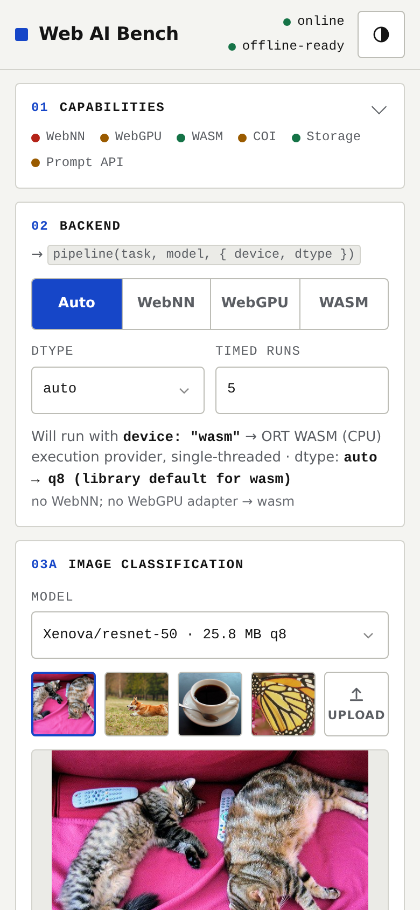
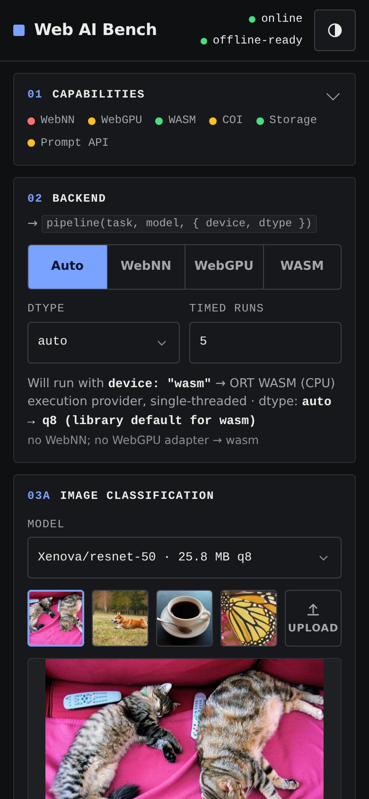
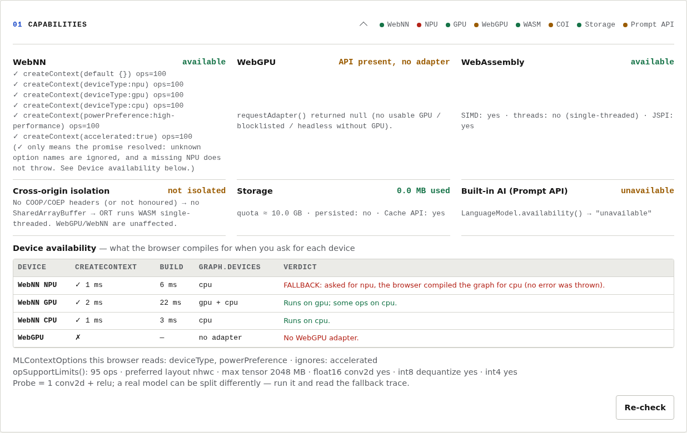
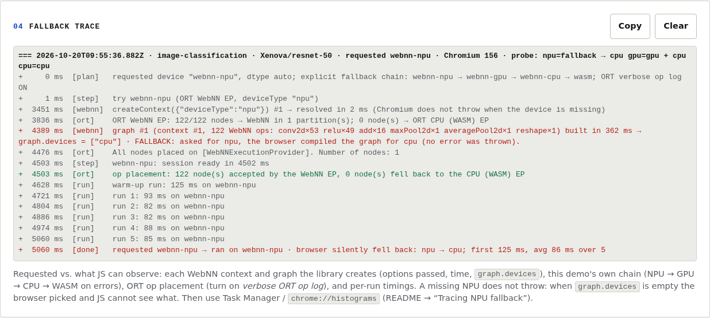

# The Ultimate Guide to Browser-Based AI

**Privacy-First, Offline-Ready, and Fully Future-Proof** — talk by Maxim Salnikov, October 2026 edition.

Generative and intelligent features are quickly becoming a core part of modern web experiences—but they often come with trade-offs: privacy concerns, reliance on internet connectivity, and the cost of using cloud-based APIs. What if you could bring powerful AI directly into the browser, on the user's device? In this session, we'll explore the full landscape of browser-based AI and machine learning—no servers required. From text generation and image recognition to real-time transcription and offline copilots, the web platform now provides a rich toolbox of APIs and tools to enable truly private, performant, and intelligent experiences.

**Live demo:** https://webai.isainative.dev/ (GitHub Pages from the `gh-pages` branch)

## What's inside

| Folder | What |
|---|---|
| [`deck/`](deck/) | The deck (35 slides, PPTX + PDF), the talk track as PDF (slide thumbnail + script per page) and as Markdown |
| [`demo/`](demo/) | **Web AI Bench** — the rebuilt WebNN demo: Transformers.js 4.3.1, WebNN / WebGPU / WASM switcher, offline-ready, mobile-first |
| [`docs/`](docs/) | Research with primary sources ([`research.md`](docs/research.md)), the story and slide plan ([`story.md`](docs/story.md)), slide-to-source traceability ([`slides-outline.md`](docs/slides-outline.md)), what changed since the previous deck ([`analysis.md`](docs/analysis.md)), the browser/vendor assumptions audit of the demo ([`ASSUMPTIONS-AUDIT.md`](docs/ASSUMPTIONS-AUDIT.md)), demo [screenshots](docs/screenshots/) |

## The demo: Web AI Bench

A static rebuild of my earlier `nextjs-webnn` demo (Next.js, Transformers.js 3.4.2) — no framework, no build step. Mobile-first (it is opened from a QR code on phones), light and dark, system fonts only, so it also works offline.

<p> </p>

- **Device switcher:** Auto · WebNN (NPU / GPU / CPU) · WebGPU · WASM. Auto feature-detects and tells you what it picked and why.
- **Device availability + fallback trace:** NPU / GPU / CPU probed with a real graph and `graph.devices`, and a copyable trace of what each run requested vs. what ran — see [Tracing NPU fallback](#tracing-npu-fallback).
- **Capability panel:** WebNN contexts, WebGPU adapter (`shader-f16`, subgroups), WASM threads/SIMD, cross-origin isolation, storage, Prompt API availability.
- **Three tasks:** image classification (ResNet-50, MobileNet-v2 from the Hugging Face `webnn` org), speech-to-text (Whisper tiny.en), and the built-in Prompt API with a fallback to SmolLM2-135M via Transformers.js.
- **Numbers on screen:** load time, warm-up, average of N runs, tokens/s, and a benchmark board that accumulates results per device (copy as Markdown).
- **Offline:** inference runs in a Web Worker; a service worker caches the app shell and the library, Transformers.js caches the models in Cache Storage. After one load it works with the network off.

Build notes, exact device strings, models, sizes and measured timings: [`demo/NOTES.md`](demo/NOTES.md).

### Run it locally

Any static server works, for example:

```bash
cd demo
python3 -m http.server 8080
# open http://localhost:8080
```

- Use `localhost` or HTTPS — service workers and WebGPU need a secure context.
- Models are downloaded from the Hugging Face Hub on first use and cached by the browser.
- WASM multi-threading needs cross-origin isolation (COOP/COEP). Without those headers ONNX Runtime Web runs single-threaded — fine for the demo, and the capability panel says which mode you got. `demo/_headers` has the headers for hosts that read that file.
- WebNN in Chrome/Edge is behind `about://flags/#web-machine-learning-neural-network` (as of Oct 2026).

## Tracing NPU fallback

*Researched and tested 20 Oct 2026. Sources are pinned to Chromium `b9bd6ac815` and ONNX Runtime `a7a1172c9a` (both `main` that day).*

### What happens when you ask for the NPU

The demo's **WebNN → NPU** mode is Transformers.js `device: 'webnn-npu'`. That becomes the ONNX Runtime Web WebNN execution provider with `deviceType: 'npu'`, which calls `navigator.ml.createContext({ deviceType: 'npu' })` ([wasm-core-impl.ts](https://github.com/microsoft/onnxruntime/blob/a7a1172c9a044629bb12c75fb2a89c0c347c7f28/js/web/lib/wasm/wasm-core-impl.ts#L392)). There are **two layers** where work can leave the NPU:

1. **In the page (ONNX Runtime Web).** The WebNN EP takes only the nodes WebNN can run. Every other node (an unsupported op, a dynamic shape, an unsupported data type) runs on ORT's CPU (WASM) EP. **This layer is observable:** at log severity 0 ORT logs `Operator type: [X] … supported: [0/1]` for every node ([helper.cc](https://github.com/microsoft/onnxruntime/blob/a7a1172c9a044629bb12c75fb2a89c0c347c7f28/onnxruntime/core/providers/webnn/builders/helper.cc#L216)) and a `number of nodes supported by WebNN` summary ([webnn_execution_provider.cc](https://github.com/microsoft/onnxruntime/blob/a7a1172c9a044629bb12c75fb2a89c0c347c7f28/onnxruntime/core/providers/webnn/webnn_execution_provider.cc#L148)).
2. **In the browser (Chromium's WebNN service).** A missing NPU **does not throw**. `createContext({deviceType:'npu'})` resolves, and the backend picks the device:
   - **Windows (Windows ML / ONNX Runtime):** first NPU; if there is none, or its driver version is blocked → first GPU (a software GPU like WARP doesn't count) → CPU. The ORT CPU EP is always added for ops the chosen device can't run ([environment.cc `SelectEpDevicesForNpu`](https://source.chromium.org/chromium/chromium/src/+/b9bd6ac815b7dc644f4219daf9b0a88b157ff0a8:services/webnn/ort/environment.cc;l=386), [GPU/CPU selection](https://source.chromium.org/chromium/chromium/src/+/b9bd6ac815b7dc644f4219daf9b0a88b157ff0a8:services/webnn/ort/environment.cc;l=246)).
   - **macOS (Core ML):** `npu` maps to `MLComputeUnitsAll`, so Core ML decides per op (`CPUAndNeuralEngine` only behind the `WebNNCoreMLExplicitGPUOrNPU` feature) ([graph_impl_coreml.mm](https://source.chromium.org/chromium/chromium/src/+/b9bd6ac815b7dc644f4219daf9b0a88b157ff0a8:services/webnn/coreml/graph_impl_coreml.mm;l=790)).
   - **ChromeOS / Android / Linux (LiteRT):** the devices that actually got delegated nodes are recorded ([graph_impl_litert.cc](https://source.chromium.org/chromium/chromium/src/+/b9bd6ac815b7dc644f4219daf9b0a88b157ff0a8:services/webnn/tflite/graph_impl_litert.cc;l=285)).

### What JavaScript can see

| Signal | Shows | Where it works |
|---|---|---|
| `createContext()` resolves or rejects | only "WebNN works at all". A missing NPU still resolves | everywhere |
| `MLGraph.devices` (Chromium-only attribute, [ml_graph.idl](https://source.chromium.org/chromium/chromium/src/+/b9bd6ac815b7dc644f4219daf9b0a88b157ff0a8:third_party/blink/renderer/modules/ml/webnn/ml_graph.idl;l=11)) | the devices the compiled graph runs on, e.g. `["cpu"]` after asking for `npu` | **Core ML and LiteRT fill it. Windows ML/ORT leaves it empty** ([TODO crbug.com/418031018](https://source.chromium.org/chromium/chromium/src/+/b9bd6ac815b7dc644f4219daf9b0a88b157ff0a8:services/webnn/ort/graph_impl_ort.cc;l=334)) |
| `MLContext.accelerated` (spec) | CPU vs "massively parallel" | in the spec, **not in Chromium** |
| `opSupportLimits()` | ops and data types the context supports | Chromium |
| ORT Web verbose log | per node: WebNN EP or CPU (WASM) EP | everywhere (this demo parses it) |

The spec itself says device selection "does not expose the actual device selected for execution" ([WebNN ED, fingerprinting](https://webmachinelearning.github.io/webnn/#fingerprinting)). It also **removed `deviceType`**, keeping `powerPreference` + `accelerated` ([#809](https://github.com/webmachinelearning/webnn/pull/809); [MLContextOptions](https://webmachinelearning.github.io/webnn/#api-mlcontextoptions)). Chromium still reads `deviceType` (default `"cpu"`) and `powerPreference`, and ignores `accelerated` ([ml_context_options.idl](https://source.chromium.org/chromium/chromium/src/+/b9bd6ac815b7dc644f4219daf9b0a88b157ff0a8:third_party/blink/renderer/modules/ml/ml_context_options.idl;l=25); confirmed by the demo's getter test in Chrome 156).

### What the demo does

- **Capabilities → Device availability.** For each of NPU / GPU / CPU: `createContext({deviceType})` (timed), build a 1-conv graph, then read `graph.devices`. The verdict is one of:
  - *Runs on npu*
  - *FALLBACK: asked for npu, the browser compiled the graph for cpu*
  - *Browser picked; not observable from JS*, when `devices` is empty or missing

  The table also shows the WebGPU adapter, which `MLContextOptions` members the browser actually reads (getter probe), and an `opSupportLimits()` summary. Auto mode no longer trusts a resolved NPU context on its own.
- **04 · Fallback trace** (copyable). For every run it logs:
  - each WebNN context and graph the library creates: the options ORT passed, the time, the WebNN op count, and `graph.devices` (the worker wraps `navigator.ml.createContext` and `MLGraphBuilder.build`);
  - the demo's own **explicit chain** when a step fails: `webnn-npu → webnn-gpu → webnn-cpu → wasm`, each step with its reason and time. A model or network error stops the chain;
  - with **verbose ORT op log** on: how many nodes went to WebNN and which op types fell back to the CPU (WASM) EP;
  - per-run timings, and a final line: requested vs. used vs. what the browser reported.

  Everything is also printed to the console with the prefix `[fallback-trace]`.
- Vision models now get `freeDimensionOverrides` on WebNN. Without them ResNet-50 had dynamic shapes and **120 of 122 nodes silently ran on WASM**: 444 ms → 86 ms per run in headless Chrome 156.

<p><br></p>

### Seeing the device on Windows (outside JS)

| Tool | How | What you get |
|---|---|---|
| **Task Manager** | Performance tab → **NPU** graph. Processes tab → right-click a column header → **NPU**, **NPU engine** ([Microsoft](https://techcommunity.microsoft.com/blog/windows-itpro-blog/task-manager-features-for-visibility-into-ai-workloads/4545150)) | NPU utilisation while you press Run (the only visual check on a real NPU) |
| **`chrome://histograms/WebNN.ORT`** (`edge://histograms/…`) | after one WebNN run | `WebNN.ORT.FirstSelectedDevice`: 0 = CPU, 1 = GPU, **2 = NPU**; `WebNN.ORT.FirstSelectedEP`: 1 CPU, 2 DML, 3 WebGPU, 4 MIGraphX, 5 TensorRT-RTX, 6 OpenVINO, 7 QNN, 8 VitisAI ([context_impl_ort.cc](https://source.chromium.org/chromium/chromium/src/+/b9bd6ac815b7dc644f4219daf9b0a88b157ff0a8:services/webnn/ort/context_impl_ort.cc;l=61)) |
| **Browser log** | launch with `--enable-logging --v=0 --webnn-ort-logging-level=INFO` ([switch](https://source.chromium.org/chromium/chromium/src/+/b9bd6ac815b7dc644f4219daf9b0a88b157ff0a8:services/webnn/webnn_switches.h;l=35)); read `chrome_debug.log` in the user-data dir ([chromium.org](https://www.chromium.org/for-testers/enable-logging/)) | `[WebNN] [INFO] Selected OrtEpDevice #0: {ep_name: …, OrtHardwareDevice: {type: npu…}}` ([ort_session_options.cc](https://source.chromium.org/chromium/chromium/src/+/b9bd6ac815b7dc644f4219daf9b0a88b157ff0a8:services/webnn/ort/ort_session_options.cc;l=79)); `The NPU driver version is blocked … Falling back to GPU.`; `VERBOSE` adds ORT's own per-node placement |
| **Make fallback loud** | `--webnn-ort-disable-cpu-fallback` ([switch](https://source.chromium.org/chromium/chromium/src/+/b9bd6ac815b7dc644f4219daf9b0a88b157ff0a8:services/webnn/webnn_switches.h;l=135)) | session creation fails if the NPU EP can't take every node. The demo's chain then logs the failure and moves to GPU |
| **ORT profile** | `--no-sandbox --webnn-ort-enable-profiling=WebNNNpu` ([switch](https://source.chromium.org/chromium/chromium/src/+/b9bd6ac815b7dc644f4219daf9b0a88b157ff0a8:services/webnn/webnn_switches.h;l=125)) | a JSON profile with per-node timing |
| **Tracing** | `chrome://tracing` or [Perfetto](https://ui.perfetto.dev) → enable category **`webnn`** ([webnn_trace.cc](https://source.chromium.org/chromium/chromium/src/+/b9bd6ac815b7dc644f4219daf9b0a88b157ff0a8:services/webnn/public/cpp/webnn_trace.cc;l=14)) | spans like `WebNNContextProviderImpl::CreateWebNNContext` and `SessionOptions::Create` |
| **`chrome://gpu`** | Graphics Feature Status → **WebNN** ([compositor_util.cc](https://source.chromium.org/chromium/chromium/src/+/b9bd6ac815b7dc644f4219daf9b0a88b157ff0a8:content/browser/gpu/compositor_util.cc;l=212)) | whether WebNN is disabled in the GPU process |

PowerShell 5.1, Edge. The same switches work for `chrome.exe`. The separate profile dir makes the flags take effect even if Edge is already open:

```powershell
$edge = "${env:ProgramFiles(x86)}\Microsoft\Edge\Application\msedge.exe"
$dir  = "$env:TEMP\webnn-trace"
& $edge --user-data-dir="$dir" --enable-features=WebMachineLearningNeuralNetwork --enable-logging --v=0 --webnn-ort-logging-level=INFO https://webai.isainative.dev/
# after a WebNN run:
Select-String -Path "$dir\chrome_debug.log" -Pattern "OrtEpDevice|NPU driver|Falling back" | Select-Object -First 30
```

**Verified here:** Chrome 156 headless on Linux (LiteRT, no NPU, no GPU). `deviceType:'npu'` resolves in ~1 ms and `graph.devices` is `["cpu"]`; the demo shows *FALLBACK*. Without the WebNN flag, the chain ends on WASM. **Not verified:** Windows ML on a real NPU, the Edge-specific behaviour, and whether Chrome/Edge *stable* already ship every switch above (they are in Chromium `main`).

## Key facts (as of 16 Oct 2026)

Every claim with its primary source and read date is in [`docs/research.md`](docs/research.md).

- **WebNN:** W3C Candidate Recommendation (snapshot 22 Jan 2026; CR Draft 10 Oct 2026). In Chrome and Edge it is **flag-only** — Chrome's origin trial was pulled on 27 Mar 2026, Edge's expired on 11 Aug 2026. Firefox: positive position; Safari: no position.
- **WebNN backends:** Windows 11 24H2+ → Windows ML / ONNX Runtime (NPU, GPU); macOS 14.4+ on Apple Silicon → Core ML; elsewhere LiteRT (CPU).
- **Device selection:** the spec now uses `powerPreference` + `accelerated`; Chromium still accepts `deviceType: 'cpu' | 'gpu' | 'npu'`, which is what ONNX Runtime Web and Transformers.js pass. Asking for `npu` without an NPU does not throw — see [Tracing NPU fallback](#tracing-npu-fallback).
- **WebGPU:** Chrome 113 (2023), Edge, Android Chrome 121, Linux Chrome 144; Firefox 141 on Windows, 145 on macOS 26 (Apple Silicon); Safari 26.0 on macOS, iOS, iPadOS and visionOS.
- **Built-in AI:** the Prompt API is stable on the web in Chrome 148.
- **Transformers.js 4.3.1** (6 Oct 2026): 4,272 models on the Hub, ONNX Runtime Web 1.31-dev, devices incl. `webnn-npu` / `webnn-gpu` / `webnn-cpu`, dtypes fp32…q4f16, default q8 on WASM.
- **Other runtimes:** WebLLM 0.2.86, ONNX Runtime Web 1.30.0, LiteRT.js 2.5.3; TensorFlow.js last released Oct 2024.
- **On-device speech:** Web Speech API with `processLocally` since Chrome 139.
- **Storage:** about 60 % of disk per origin in Chromium and WebKit.

**Not verified here:** WebNN on a real NPU — the demo's WebNN path is built from the spec and library source, and is meant to be measured on stage hardware.

## More from me

- Book: *Tools, Not Clicks* (WebMCP) — https://vibeprogrammer.github.io/webmcp-book/
- Newsletter: https://isainative.substack.com

## License

- Code in [`demo/`](demo/) is MIT-licensed — see [LICENSE](LICENSE).
- The deck, talk track and documents in [`deck/`](deck/) and [`docs/`](docs/) are © 2026 Maxim Salnikov, all rights reserved.
- Sample media and models belong to their respective owners.
